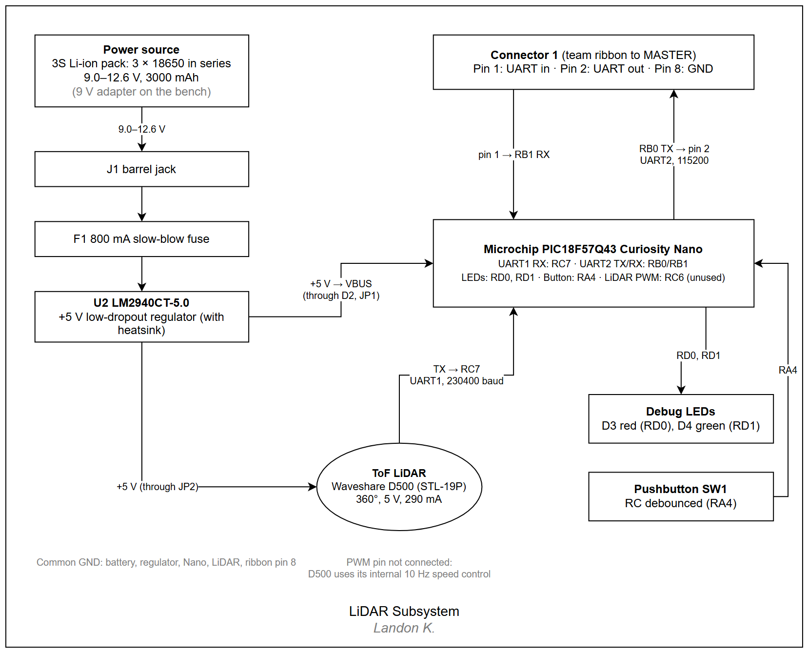

## Overview

Power and data flow for my LiDAR subsystem. It connects to the MASTER board through Connector 1 in the [team block diagram](https://ras4-f26-2028-team-1.github.io/RAS304-F26-team1.github.io/06-team-block-diagram/).

**Figure 1:** LiDAR subsystem block diagram.

## Blocks

* **Power source:** 3S Li-ion pack (9.0–12.6 V) into J1, or a 9 V adapter on the bench.
* **Protection and regulation:** 750 mA fuse (F1), then the LM2940CT-5.0 (U2) makes +5 V.
* **Power levels:** +5 V to the LiDAR and the Nano's VBUS. The Nano makes 3.3 V. Common ground, including ribbon pin 8.
* **Sensor:** D500 LiDAR TX to RC7 (UART1, 230400 baud). PWM is left unconnected.
* **Actuator:** None.
* **Debugging:** LEDs on RD0 and RD1, pushbutton on RA4.
* **Team connection:** UART2 (115200 baud): RB0 TX to ribbon pin 2, ribbon pin 1 to RB1 RX.

## Changes Since the First Version

* Added the power path (battery, fuse, regulator).
* Changed the LiDAR link to TX only (the D500 has no RX line).
* Added the LEDs and pushbutton, and labeled each connection.

## Source Files

* Block diagram source (draw.io): [LiDAR_Block_Diagram_LK.drawio](LiDAR_Block_Diagram_LK.drawio)
* ZIP of the source and image files: [LiDAR_Block_Diagram_LK_source.zip](LiDAR_Block_Diagram_LK_source.zip)
