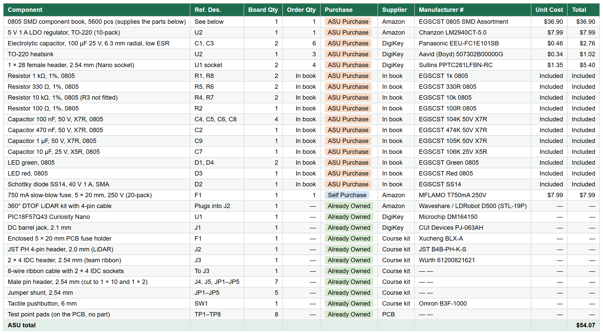

## Overview

Every part on my LiDAR subsystem board, from the [schematic](../04-Schematic/Schematics.md). Each line is tagged:

* ASU Purchase requested on a class order form
* Already Owned on hand from the course kit or class stock, or bought earlier

Order quantities cover a breadboard build, the PCB, and spares. 0805 parts only go on the PCB, so they come from the component book. C1 and C3 use the same 100 µF low-ESR capacitor, which meets the LM2940's output requirement (at least 22 µF, ESR 0.1 to 1 Ω). Prices are single-quantity, without shipping or tax.

## Cost Summary

| Purchase | Supplier | Order form | Cost |
|---|---|---|---:|
| ASU Purchase | DigiKey | [Purchase request (DigiKey)](Purchase_Request_DigiKey_LKuhman.pdf) | &#92;&#36;9.18 |
| ASU Purchase | Amazon | [Purchase request (Amazon)](Purchase_Request_Amazon_LKuhman.pdf) | &#92;&#36;36.90 |
| **ASU total** | | | **&#92;&#36;46.08** (budget &#92;&#36;60.00) |
| Already Owned | — | — | &#92;&#36;0.00 |

The 0805 component book is pending approval from Professor Thangavelu. If it is not approved, the 0805 parts and SS14 are ordered individually from DigiKey instead (about &#92;&#36;7.50).

## Bill of Materials (Spreadsheet)

Download the [Excel file](BOM_LiDAR_LK.xlsx) or the [KiCad BOM export (CSV)](LiDAR_Subsystem_LK_BOM.csv).

## Component Bill of Materials

| Component | Ref. Des. | Board Qty | Order Qty | Purchase | Manufacturer # | Unit Cost | Total | Buy From | Datasheet |
|---|---|---:|---:|---|---|---:|---:|---|---|
| 0805 SMD component book, 5600 pcs (supplies the parts below) | See below | 1 | 1 | ASU Purchase | 0805 SMD Assortment | &#92;&#36;36.90 | &#92;&#36;36.90 | [Amazon](https://www.amazon.com/dp/B0DZXQPFHP) | — |
| Electrolytic capacitor, 100 µF 25 V, 6.3 mm radial, low ESR | C1, C3 | 2 | 6 | ASU Purchase | EEU-FC1E101SB | &#92;&#36;0.46 | &#92;&#36;2.76 | [DigiKey](https://www.digikey.com/en/products/detail/panasonic-industry/EEU-FC1E101SB/2689615) | [Datasheet](https://industrial.panasonic.com/ww/products/pt/aluminum-cap-lead/models/EEUFC1E101S) |
| TO-220 heatsink | U2 | 1 | 3 | ASU Purchase | 507302B00000G | &#92;&#36;0.34 | &#92;&#36;1.02 | [DigiKey](https://www.digikey.com/en/products/detail/boyd-laconia-llc/507302B00000G/5849) | [Datasheet](datasheets/Boyd_BoardLevel_Heatsinks.pdf) |
| 1 × 28 female header, 2.54 mm (Nano socket) | U1 socket | 2 | 4 | ASU Purchase | PPTC281LFBN-RC | &#92;&#36;1.35 | &#92;&#36;5.40 | [DigiKey](https://www.digikey.com/en/products/detail/sullins-connector-solutions/PPTC281LFBN-RC/810166) | [Datasheet](https://www.sullinscorp.com/product/pptc281lfbn-rc/) |
| Resistor 1 kΩ, 1%, 0805 | R1, R8 | 2 | In book | ASU Purchase | 1k 0805 | Included | Included | [In book](https://www.amazon.com/dp/B0DZXQPFHP) | [Datasheet](https://www.seielect.com/catalog/sei-rmcf_rmcp.pdf) |
| Resistor 330 Ω, 1%, 0805 | R5, R6 | 2 | In book | ASU Purchase | 330R 0805 | Included | Included | [In book](https://www.amazon.com/dp/B0DZXQPFHP) | [Datasheet](https://www.seielect.com/catalog/sei-rmcf_rmcp.pdf) |
| Resistor 10 kΩ, 1%, 0805 (R3 not fitted) | R4, R7 | 2 | In book | ASU Purchase | 10k 0805 | Included | Included | [In book](https://www.amazon.com/dp/B0DZXQPFHP) | [Datasheet](https://www.seielect.com/catalog/sei-rmcf_rmcp.pdf) |
| Resistor 100 Ω, 1%, 0805 | R2 | 1 | In book | ASU Purchase | 100R 0805 | Included | Included | [In book](https://www.amazon.com/dp/B0DZXQPFHP) | [Datasheet](https://www.seielect.com/catalog/sei-rmcf_rmcp.pdf) |
| Capacitor 100 nF, 50 V, X7R, 0805 | C4, C5, C6, C8 | 4 | In book | ASU Purchase | 104K 50V X7R | Included | Included | [In book](https://www.amazon.com/dp/B0DZXQPFHP) | [Datasheet](https://product.samsungsem.com/mlcc/CL21B104KBCNNN.do) |
| Capacitor 470 nF, 50 V, X7R, 0805 | C2 | 1 | In book | ASU Purchase | 474K 50V X7R | Included | Included | [In book](https://www.amazon.com/dp/B0DZXQPFHP) | [Datasheet](https://product.samsungsem.com/mlcc/CL21B474KBFNNN.do) |
| Capacitor 1 µF, 50 V, X7R, 0805 | C9 | 1 | In book | ASU Purchase | 105K 50V X7R | Included | Included | [In book](https://www.amazon.com/dp/B0DZXQPFHP) | [Datasheet](https://product.samsungsem.com/mlcc/CL21B105KOFNNN.do) |
| Capacitor 10 µF, 25 V, X5R, 0805 | C7 | 1 | In book | ASU Purchase | 106K 25V X5R | Included | Included | [In book](https://www.amazon.com/dp/B0DZXQPFHP) | [Datasheet](https://product.samsungsem.com/mlcc/CL21A106KOQNNN.do) |
| LED green, 0805 | D1, D4 | 2 | In book | ASU Purchase | Green 0805 | Included | Included | [In book](https://www.amazon.com/dp/B0DZXQPFHP) | [Datasheet](https://www.we-online.com/components/products/datasheet/150080GS75000.pdf) |
| LED red, 0805 | D3 | 1 | In book | ASU Purchase | Red 0805 | Included | Included | [In book](https://www.amazon.com/dp/B0DZXQPFHP) | [Datasheet](https://www.we-online.com/components/products/datasheet/150080RS75000.pdf) |
| Schottky diode SS14, 40 V 1 A, SMA | D2 | 1 | In book | ASU Purchase | SS14 | Included | Included | [In book](https://www.amazon.com/dp/B0DZXQPFHP) | [Datasheet](datasheets/SS14_Vishay.pdf) |
| 360° DTOF LiDAR kit with 4-pin cable | Plugs into J2 | 1 | — | Already Owned | D500 (STL-19P) | — | — | [Amazon](https://www.amazon.com/dp/B0GSTXW158) | [Datasheet](https://www.waveshare.com/wiki/D500_LiDAR_Kit) |
| PIC18F57Q43 Curiosity Nano | U1 | 1 | — | Already Owned | DM164150 | — | — | [DigiKey](https://www.digikey.com/en/products/detail/microchip-technology/DM164150/11586705) | [Datasheet](https://www.microchip.com/en-us/development-tool/DM164150) |
| DC barrel jack, 2.1 mm | J1 | 1 | — | Already Owned | PJ-063AH | — | — | [DigiKey](https://www.digikey.com/en/products/detail/cui-devices/PJ-063AH/2161208) | [Datasheet](datasheets/PJ-063AH_CUI.pdf) |
| 5 V 1 A LDO regulator, TO-220 | U2 | 1 | — | Already Owned | LM2940CT-5.0 | — | — | [Course kit](https://www.amazon.com/dp/B08M31N764) | [Datasheet](datasheets/LM2940_TI.pdf) |
| Enclosed 5 × 20 mm PCB fuse holder | F1 | 1 | — | Already Owned | BLX-A | — | — | [Course kit](https://www.lcsc.com/product-detail/C3131.html) | [Datasheet](https://www.lcsc.com/product-detail/C3131.html) |
| 750 mA slow-blow fuse, 5 × 20 mm, 250 V | F1 | 1 | — | Already Owned | T750mA 250V | — | — | [Course kit](https://www.amazon.com/dp/B0B58Z38YJ) | [Datasheet](https://www.mouser.com/datasheet/2/87/eaton%20corporation_bus-elx-ds-4395-gmc-1160696.pdf) |
| JST PH 4-pin header, 2.0 mm (LiDAR) | J2 | 1 | — | Already Owned | B4B-PH-K-S | — | — | [Course kit](https://www.digikey.com/en/products/result?keywords=B4B-PH-K-S(LF)(SN)) | [Datasheet](https://www.jst-mfg.com/product/pdf/eng/ePH.pdf) |
| 2 × 4 IDC header, 2.54 mm (team ribbon) | J3 | 1 | — | Already Owned | 61200821621 | — | — | [Course kit](https://www.digikey.com/en/products/result?keywords=61200821621) | [Datasheet](https://www.we-online.com/components/products/datasheet/61200821621.pdf) |
| 8-wire ribbon cable with 2 × 4 IDC sockets | To J3 | 1 | — | Already Owned | — | — | — | Course kit | — |
| Male pin header, 2.54 mm (cut to 1 × 10 and 1 × 2) | J4, J5, JP1–JP5 | 7 | — | Already Owned | — | — | — | Course kit | — |
| Jumper shunt, 2.54 mm | JP1–JP5 | 5 | — | Already Owned | — | — | — | Course kit | — |
| Tactile pushbutton, 6 mm | SW1 | 1 | — | Already Owned | B3F-1000 | — | — | [Course kit](https://www.digikey.com/en/products/result?keywords=B3F-1000) | [Datasheet](datasheets/B3F_Omron.pdf) |
| Test point pads (on the PCB, no part) | TP1–TP8 | 8 | — | Already Owned | — | — | — | PCB | — |

## Datasheets

Datasheets for the main parts are saved in this repository in the [datasheets folder](https://github.com/lrkuhman/lrkuhman_RAS304_F26/tree/main/docs/03-BOM/datasheets). The rest link to the manufacturer.
