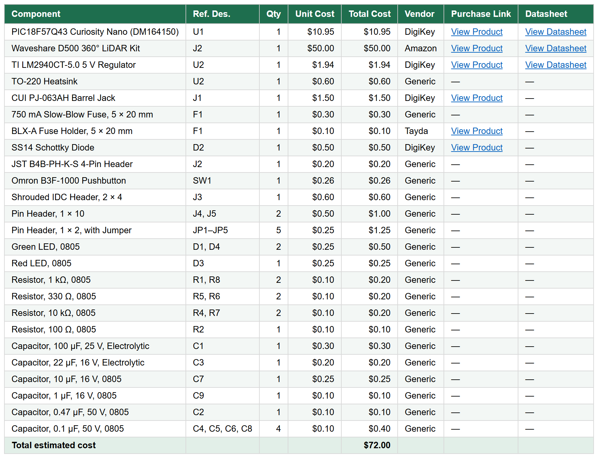

## Overview

Everything needed to build my LiDAR subsystem board. Reference designators match the [schematic](../04-Schematic/Schematics.md). Prices are approximate single-quantity prices in US dollars, without shipping.

## Bill of Materials (Spreadsheet)

Download the [Excel file](BOM_LiDAR_LK.xlsx).

## Component Bill of Materials

| Component | Ref. Des. | Qty | Unit Cost | Total Cost | Vendor | Purchase Link | Datasheet |
|---|---|---:|---:|---:|---|---|---|
| PIC18F57Q43 Curiosity Nano (DM164150) | U1 | 1 | &#92;&#36;10.95 | &#92;&#36;10.95 | DigiKey | [View Product](https://www.digikey.com/en/products/detail/microchip-technology/DM164150/11586705) | [View Datasheet](https://www.microchip.com/en-us/development-tool/DM164150) |
| Waveshare D500 360° LiDAR Kit | J2 | 1 | &#92;&#36;50.00 | &#92;&#36;50.00 | Amazon | [View Product](https://www.amazon.com/dp/B0GSTXW158) | [View Datasheet](https://www.waveshare.com/wiki/D500_LiDAR_Kit) |
| TI LM2940CT-5.0 5 V Regulator | U2 | 1 | &#92;&#36;1.94 | &#92;&#36;1.94 | DigiKey | [View Product](https://www.digikey.com/en/products/detail/texas-instruments/LM2940CT-5-0-NOPB/32575) | [View Datasheet](https://www.ti.com/lit/ds/symlink/lm2940-n.pdf) |
| Aavid 507002B00000G TO-220 Heatsink | U2 | 1 | &#92;&#36;0.70 | &#92;&#36;0.70 | DigiKey | [View Product](https://www.digikey.com/en/products/detail/boyd-laconia-llc/507002B00000G/5846) | [View Datasheet](https://info.boydcorp.com/hubfs/Thermal/Air-Cooling/Boyd-Board-Level-Heatsinks-Catalog.pdf) |
| CUI PJ-063AH Barrel Jack | J1 | 1 | &#92;&#36;1.50 | &#92;&#36;1.50 | DigiKey | [View Product](https://www.digikey.com/en/products/detail/cui-devices/PJ-063AH/2161208) | [View Datasheet](https://www.sameskydevices.com/product/resource/pj-063ah.pdf) |
| Littelfuse 0218.800MXP 800 mA Slow-Blow Fuse | F1 | 1 | &#92;&#36;0.40 | &#92;&#36;0.40 | DigiKey | [View Product](https://www.digikey.com/en/products/result?keywords=0218.800MXP) | [View Datasheet](https://www.littelfuse.com/~/media/electronics/datasheets/fuses/littelfuse_fuse_218_datasheet.pdf.pdf) |
| BLX-A Fuse Holder with Cover, 5 × 20 mm | F1 | 1 | &#92;&#36;0.10 | &#92;&#36;0.10 | Tayda | [View Product](https://www.taydaelectronics.com/fuse-holder-with-cover-5x20mm-blx-a-pcb-6-3a-250v.html) | [View Datasheet](https://www.lcsc.com/product-detail/C3131.html) |
| onsemi SS14 Schottky Diode | D2 | 1 | &#92;&#36;0.50 | &#92;&#36;0.50 | DigiKey | [View Product](https://www.digikey.com/en/products/detail/onsemi/SS14/965474) | [View Datasheet](https://www.onsemi.com/pdf/datasheet/ss14-d.pdf) |
| JST B4B-PH-K-S 4-Pin Header | J2 | 1 | &#92;&#36;0.20 | &#92;&#36;0.20 | DigiKey | [View Product](https://www.digikey.com/en/products/result?keywords=B4B-PH-K-S(LF)(SN)) | [View Datasheet](https://www.jst-mfg.com/product/pdf/eng/ePH.pdf) |
| Omron B3F-1000 Pushbutton | SW1 | 1 | &#92;&#36;0.26 | &#92;&#36;0.26 | DigiKey | [View Product](https://www.digikey.com/en/products/result?keywords=B3F-1000) | [View Datasheet](https://omronfs.omron.com/en_US/ecb/products/pdf/en-b3f.pdf) |
| Würth 61200821621 Box Header, 2 × 4 | J3 | 1 | &#92;&#36;0.60 | &#92;&#36;0.60 | DigiKey | [View Product](https://www.digikey.com/en/products/result?keywords=61200821621) | [View Datasheet](https://www.we-online.com/components/products/datasheet/61200821621.pdf) |
| Würth 61301011121 Pin Header, 1 × 10 | J4, J5 | 2 | &#92;&#36;0.50 | &#92;&#36;1.00 | DigiKey | [View Product](https://www.digikey.com/en/products/result?keywords=61301011121) | [View Datasheet](https://www.we-online.com/components/products/datasheet/61301011121.pdf) |
| Würth 61300211121 Pin Header, 1 × 2 | JP1–JP5 | 5 | &#92;&#36;0.15 | &#92;&#36;0.75 | DigiKey | [View Product](https://www.digikey.com/en/products/result?keywords=61300211121) | [View Datasheet](https://www.we-online.com/components/products/datasheet/61300211121.pdf) |
| Würth 60900213421 Jumper Shunt | JP1–JP5 | 5 | &#92;&#36;0.15 | &#92;&#36;0.75 | DigiKey | [View Product](https://www.digikey.com/en/products/result?keywords=60900213421) | [View Datasheet](https://www.we-online.com/components/products/datasheet/60900213421.pdf) |
| Würth 150080GS75000 Green LED, 0805 | D1, D4 | 2 | &#92;&#36;0.25 | &#92;&#36;0.50 | DigiKey | [View Product](https://www.digikey.com/en/products/result?keywords=150080GS75000) | [View Datasheet](https://www.we-online.com/components/products/datasheet/150080GS75000.pdf) |
| Würth 150080RS75000 Red LED, 0805 | D3 | 1 | &#92;&#36;0.25 | &#92;&#36;0.25 | DigiKey | [View Product](https://www.digikey.com/en/products/result?keywords=150080RS75000) | [View Datasheet](https://www.we-online.com/components/products/datasheet/150080RS75000.pdf) |
| Stackpole RMCF0805FT1K00 1 kΩ Resistor | R1, R8 | 2 | &#92;&#36;0.10 | &#92;&#36;0.20 | DigiKey | [View Product](https://www.digikey.com/en/products/result?keywords=RMCF0805FT1K00) | [View Datasheet](https://www.seielect.com/catalog/sei-rmcf_rmcp.pdf) |
| Stackpole RMCF0805FT330R 330 Ω Resistor | R5, R6 | 2 | &#92;&#36;0.10 | &#92;&#36;0.20 | DigiKey | [View Product](https://www.digikey.com/en/products/result?keywords=RMCF0805FT330R) | [View Datasheet](https://www.seielect.com/catalog/sei-rmcf_rmcp.pdf) |
| Stackpole RMCF0805FT10K0 10 kΩ Resistor | R4, R7 | 2 | &#92;&#36;0.10 | &#92;&#36;0.20 | DigiKey | [View Product](https://www.digikey.com/en/products/result?keywords=RMCF0805FT10K0) | [View Datasheet](https://www.seielect.com/catalog/sei-rmcf_rmcp.pdf) |
| Stackpole RMCF0805FT100R 100 Ω Resistor | R2 | 1 | &#92;&#36;0.10 | &#92;&#36;0.10 | DigiKey | [View Product](https://www.digikey.com/en/products/result?keywords=RMCF0805FT100R) | [View Datasheet](https://www.seielect.com/catalog/sei-rmcf_rmcp.pdf) |
| Panasonic EEU-FR1E101 100 µF 25 V Capacitor | C1 | 1 | &#92;&#36;0.40 | &#92;&#36;0.40 | DigiKey | [View Product](https://www.digikey.com/en/products/result?keywords=EEU-FR1E101) | [View Datasheet](https://industrial.panasonic.com/cdbs/www-data/pdf/RDF0000/ABA0000C1209.pdf) |
| Panasonic EEU-FR1C220 22 µF 16 V Capacitor | C3 | 1 | &#92;&#36;0.25 | &#92;&#36;0.25 | DigiKey | [View Product](https://www.digikey.com/en/products/result?keywords=EEU-FR1C220) | [View Datasheet](https://industrial.panasonic.com/cdbs/www-data/pdf/RDF0000/ABA0000C1209.pdf) |
| Samsung CL21A106KOQNNNE 10 µF 16 V Capacitor | C7 | 1 | &#92;&#36;0.20 | &#92;&#36;0.20 | DigiKey | [View Product](https://www.digikey.com/en/products/result?keywords=CL21A106KOQNNNE) | [View Datasheet](https://product.samsungsem.com/mlcc/CL21A106KOQNNN.do) |
| Samsung CL21B105KOFNNNE 1 µF 16 V Capacitor | C9 | 1 | &#92;&#36;0.10 | &#92;&#36;0.10 | DigiKey | [View Product](https://www.digikey.com/en/products/result?keywords=CL21B105KOFNNNE) | [View Datasheet](https://product.samsungsem.com/mlcc/CL21B105KOFNNN.do) |
| Samsung CL21B474KBFNNNE 0.47 µF 50 V Capacitor | C2 | 1 | &#92;&#36;0.10 | &#92;&#36;0.10 | DigiKey | [View Product](https://www.digikey.com/en/products/result?keywords=CL21B474KBFNNNE) | [View Datasheet](https://product.samsungsem.com/mlcc/CL21B474KBFNNN.do) |
| Samsung CL21B104KBCNNNC 0.1 µF 50 V Capacitor | C4, C5, C6, C8 | 4 | &#92;&#36;0.10 | &#92;&#36;0.40 | DigiKey | [View Product](https://www.digikey.com/en/products/result?keywords=CL21B104KBCNNNC) | [View Datasheet](https://product.samsungsem.com/mlcc/CL21B104KBCNNN.do) |

**Total estimated cost: &#92;&#36;72.55**

## Battery Pack

| Component | Qty | Unit Cost | Total Cost | Vendor | Purchase Link | Datasheet |
|---|---:|---:|---:|---|---|---|
| POWOBEST 18650 Cell, 3000 mAh | 3 | — | — | Amazon | [View Product](https://www.amazon.com/s?k=POWOBEST+3000mAh+18650+POWO18B) | [View Datasheet](https://www.amazon.com/s?k=POWOBEST+3000mAh+18650+POWO18B) |
| DIANN 18650 Battery Holder with Leads | 3 | — | — | Amazon | [View Product](https://www.amazon.com/s?k=DIANN+18650+battery+holder+single) | [View Datasheet](https://www.amazon.com/s?k=DIANN+18650+battery+holder+single) |
| HiLetgo TP4056 USB-C Charger Module | 3 | — | — | Amazon | [View Product](https://www.amazon.com/dp/B07PKND8KG) | [View Datasheet](https://dlnmh9ip6v2uc.cloudfront.net/datasheets/Prototyping/TP4056.pdf) |
| CUI PP3-002A 2.1 mm DC Barrel Plug | 1 | — | — | DigiKey | [View Product](https://www.digikey.com/en/products/result?keywords=PP3-002A) | [View Datasheet](https://www.sameskydevices.com/product/resource/pp3-002a.pdf) |

