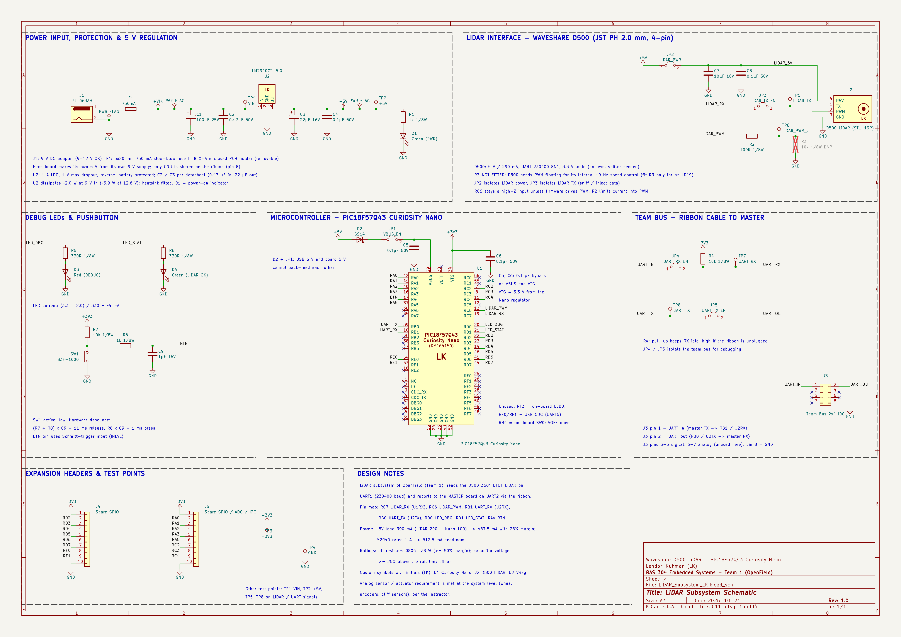
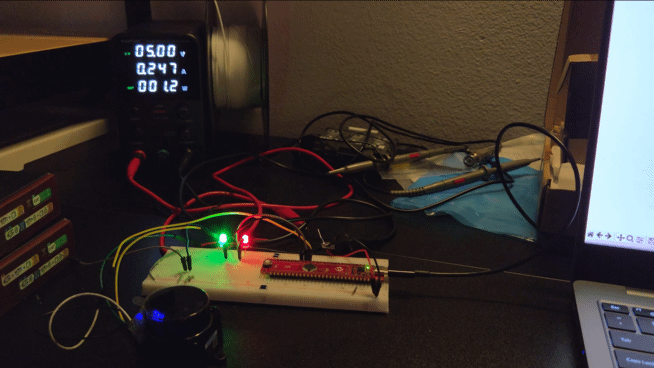
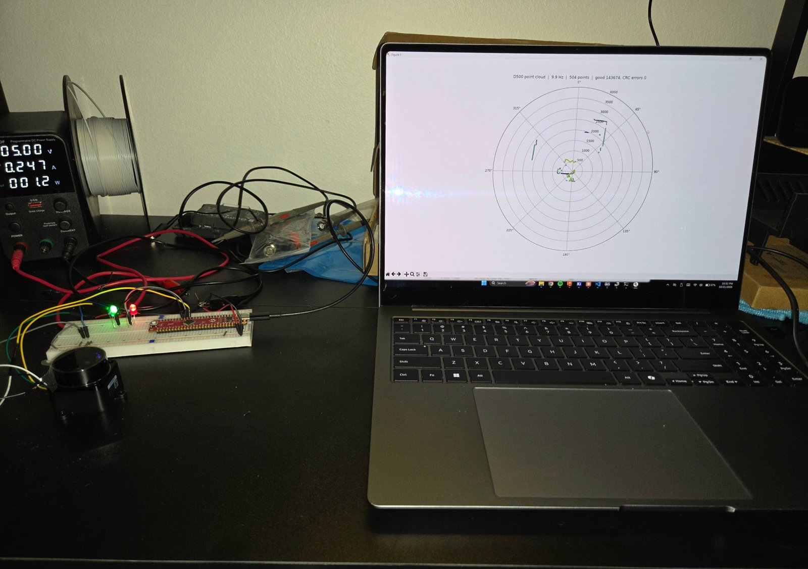
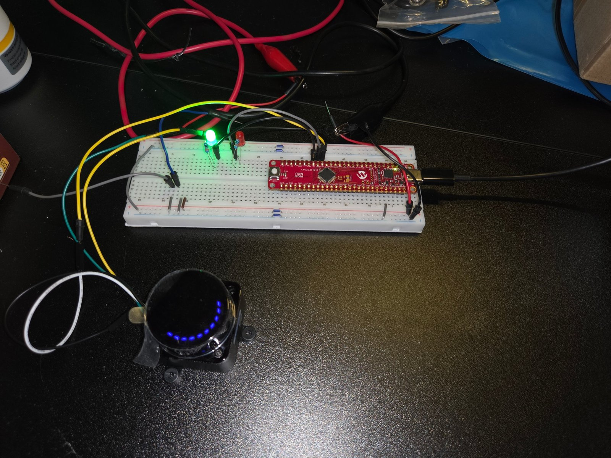

## Overview

This schematic is for my **LiDAR subsystem** board in OpenField (Team 1). The board uses a PIC18F57Q43 Curiosity Nano to read a Waveshare D500 360° time-of-flight LiDAR on UART1 at 230400 baud. It processes the scan and sends the results to the team's MASTER board over UART2, through the 8-pin team ribbon cable shown in the [team block diagram](https://ras4-f26-2028-team-1.github.io/RAS304-F26-team1.github.io/06-team-block-diagram/).

The parts match my [Component Selection](../02-Component-Selection/Component-Selection.md) and [Power Budget](../05-Power-Budget/Power-Budget.md) pages: a D500 LiDAR, an LM2940CT-5.0 linear regulator, and a 502.5 mA load on the +5 V rail (including the 25% safety margin).

**Figure 1:** LiDAR subsystem schematic, drawn in KiCad. Click the image to enlarge it.

## Schematic Sections

| Section | What it does | Key parts |
| --- | --- | --- |
| **Power input, protection & 5 V regulation** | Accepts the board's own supply through a barrel jack: a 3S Li-ion battery pack (9.0–12.6 V) on the robot, or a 9 V DC adapter on the bench. The input passes through a removable 800 mA slow-blow fuse in an enclosed BLX-A holder. The fuse is sized for a 420 mA input load plus the LiDAR motor's start-up current. The 5 V rail is made by a through-hole linear LDO with the input and output capacitors its datasheet requires. A green LED shows the board is powered. Per the course project description, each board makes its own 5 V; only ground is shared over the ribbon. | J1 PJ-063AH, F1 800 mA T in a BLX-A enclosed 5×20 mm holder, U2 LM2940CT-5.0 (TO-220, with heatsink), C1 100 µF/25 V, C2 0.47 µF/50 V, C3 22 µF/16 V, C4 0.1 µF, D1 |
| **Microcontroller** | PIC18F57Q43 Curiosity Nano, drawn with my custom symbol (LK). The 5 V rail feeds the Nano's VBUS pin through a Schottky diode and a jumper, so a USB cable plugged into the Nano can't back-feed the board, and the board can't back-feed the USB port. VBUS and VTG each have a 0.1 µF bypass capacitor. Unused pins are marked no-connect. | U1, D2 SS14, JP1, C5, C6 |
| **LiDAR interface** | 4-pin **JST PH 2.0 mm** through-hole header for the D500 (5 V, TX, PWM, GND). The LiDAR has its own power jumper and local capacitors (10 µF + 0.1 µF). Its TX line goes through a jumper to the PIC's UART1 RX. The PWM input is left floating (RC6 stays a high-impedance input) so the D500 uses its internal 10 Hz speed control, as the Waveshare D500 wiki specifies; the PIC can drive it through a 100 Ω resistor if needed. R3, a 10 k pull-down, is marked do-not-fit and is only for LD19-family sensors that need PWM grounded. | J2 (custom D500 symbol, LK), JP2, JP3, C7, C8, R2, R3 (DNP), TP5, TP6 |
| **Team bus (ribbon cable)** | 2×4 IDC header to the MASTER board. Pin 1 is UART in (to RB1, the PIC's UART2 RX). Pin 2 is UART out (from RB0, UART2 TX). Pin 8 is GND. Pins 3–5 (digital) and 6–7 (analog) follow the course's team pinout and are unused on this board. Jumpers isolate both UART lines for debugging, and a 10 k pull-up keeps RX idle-high when the ribbon is unplugged. | J3, JP4, JP5, R4, TP7, TP8 |
| **Debug LEDs & pushbutton** | Red debug LED (RD0) and green "LiDAR OK" status LED (RD1), each with a 330 Ω current-limiting resistor (about 4 mA). One pushbutton on RA4 with a 10 k pull-up and an RC hardware debounce (1 k + 1 µF, about 11 ms). | D3, D4, R5, R6, SW1, R7, R8, C9 |
| **Expansion headers & test points** | Two 10-pin headers bring 16 spare GPIO pins (including ADC, I²C and SPI-capable pins) plus 3.3 V and GND out for future changes. Eight test points cover VIN, +5V, +3V3, GND, LIDAR_TX, LIDAR_PWM, UART_RX and UART_TX. | J4, J5, TP1–TP8 |

## Microcontroller Pin Map

| Signal | PIC18F57Q43 pin | Peripheral | Connects to |
| --- | --- | --- | --- |
| LIDAR_RX | RC7 | UART1 RX (PPS) | D500 TX (through JP3) |
| LIDAR_PWM | RC6 | PWM (PPS), optional | D500 PWM (through R2) |
| UART_RX | RB1 | UART2 RX (PPS) | Ribbon pin 1, from the MASTER board's TX |
| UART_TX | RB0 | UART2 TX (PPS) | Ribbon pin 2, to the MASTER board's RX |
| LED_DBG | RD0 | GPIO output | Red debug LED |
| LED_STAT | RD1 | GPIO output | Green "LiDAR OK" LED |
| BTN | RA4 | GPIO input (Schmitt trigger) | SW1, active-low |
| Spare | RA0–RA3, RA5, RC2–RC4, RD2–RD7, RE0–RE1 | GPIO / ADC / I²C / SPI | Headers J4 and J5 |

## Design Notes

* **Custom symbols (initials LK):** the Curiosity Nano (U1), the D500 LiDAR connector (J2) and the voltage regulator (U2) are custom symbols in `LK_CustomParts.kicad_sym`. The Nano symbol groups its pins by port and puts the power pins on the top and bottom edges, which keeps the wiring clean.
* **Ratings:** every resistor is 0805, 1/8 W, with at least 50% power margin (the worst case is 8 mW). Every capacitor's voltage rating is at least 25% above the rail it sits on: 25 V or 50 V on the 9–12 V rail, and 16 V or 50 V on the 5 V and 3.3 V rails.
* **Logic levels:** the D500's UART runs at 3.3 V and the Nano's VTG is 3.3 V, so the LiDAR connects directly to the PIC with no level shifter.
* **Analog sensor / actuator requirement:** per the instructor, this requirement applies to the whole system. It is met by the wheel subsystem (motor drivers and encoders) and the cliff-sensor subsystem, so the LiDAR board doesn't need its own.

## Breadboard Verification

Before finalizing the schematic, I breadboarded the core of the design: the D500 LiDAR, the Curiosity Nano and the two debug LEDs. The test checks the parts of the schematic that matter most: the LiDAR wiring and power, UART1 receiving at 230400 baud on RC7, the floating PWM pin, and the LEDs on RD0 and RD1.

**Figure 2:** The breadboard test running. The LiDAR spins, the green "LiDAR OK" LED (RD1) stays on while valid packets arrive, and the red debug LED (RD0) blinks as a heartbeat.

**How it works:** the PIC receives the D500's 47-byte packets on UART1 (RC7), checks each packet's CRC-8, and forwards the data stream to my laptop through the Curiosity Nano's USB serial port. A Python viewer on the laptop decodes the packets and plots a live 2D point cloud of the room.

| Measurement | Result |
| --- | --- |
| LiDAR supply | 5.00 V from a bench supply |
| LiDAR running current | 0.247 A (1.2 W), below the 290 mA used in the [Power Budget](../05-Power-Budget/Power-Budget.md) |
| Scan rate | 9.9 Hz with the PWM pin left floating, confirming the D500's internal speed control (R3 stays DNP) |
| Points per scan | about 504 |
| Packets received | 143,674 good, 0 CRC errors |

**Figure 3:** Live point cloud of the room drawn from the Nano's serial data, next to the bench supply reading.

**Figure 4:** Close-up of the breadboard: Curiosity Nano, debug LEDs with 330 Ω resistors, and the D500 LiDAR.

**What I learned for the PCB:**

* **Power path resistance matters.** When the LiDAR's 5 V went through the breadboard rails, its motor start-up surge dropped the voltage below the D500's 4.5 V minimum and the LiDAR kept restarting. Wired directly to the supply, it started every time. On the PCB, the 5 V and GND traces to J2 will be wide, and C7/C8 sit right at the connector.
* **Check the cable pinout.** My first attempt didn't work because the cable's wire order was reversed from what I expected. The J2 footprint pin order (1 TX, 2 PWM, 3 GND, 4 P5V) has to match the cable that will plug into it.
* **The firmware design works.** Reading the LiDAR on UART1 and reporting over a second UART is the same structure the final board uses to send data to the MASTER board on UART2.

The test firmware ([main.c](test-code/main.c), stage 6) and the point-cloud viewer ([lidar_view.py](test-code/lidar_view.py)) are available for download.

## Resources

* The schematic as a high-resolution PDF is available [*here*](LiDAR_Subsystem_LK_Schematic.pdf).
* A ZIP of the full KiCad project, including the custom symbol and footprint libraries, is available [*here*](LiDAR_Subsystem_LK.zip).
