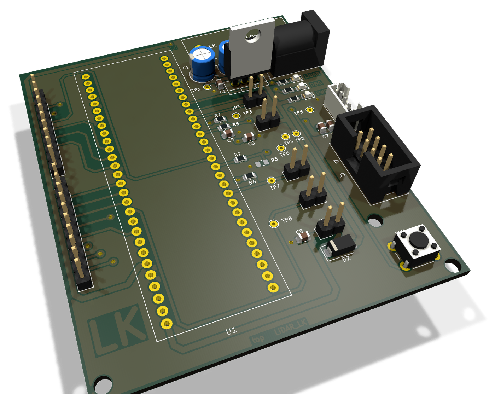
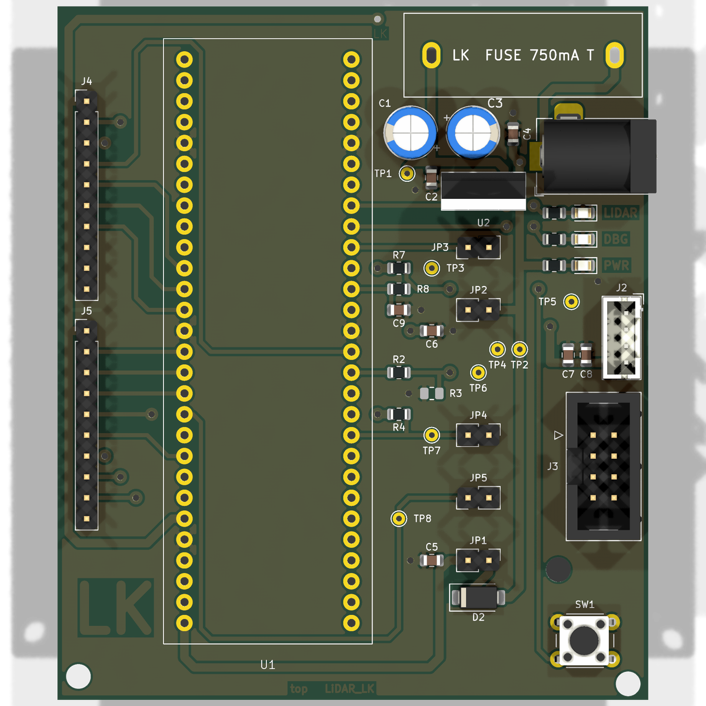
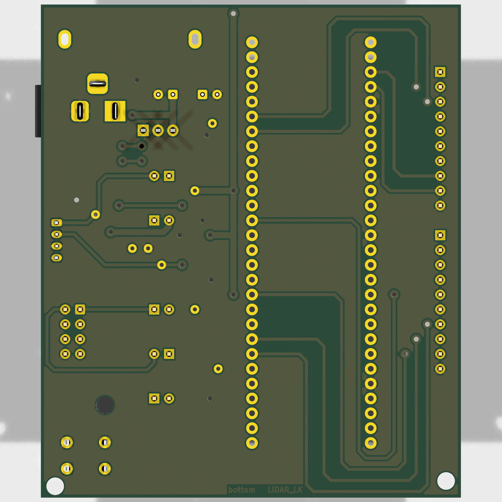

## Overview

This is the printed circuit board (PCB) for my **LiDAR subsystem**, laid out in KiCad from the [schematic](../04-Schematic/Schematics.md) (rev 1.2). It is a two-layer board milled in the lab. Every part on it is listed in the [BOM](../03-BOM/BOM.md).

**Figure 1:** 3D view of the LiDAR board from KiCad. The fuse holder and the regulator's heatsink have no 3D models, so they don't show in the render. Click any image to enlarge it.

| | |
| --- | --- |
| **Board size** | 72.0 × 84.5 mm |
| **Layers** | 2 (top and bottom copper), 1.6 mm thick |
| **Power traces** (VIN, +5V, +3V3, LiDAR 5 V) | 1.02 mm |
| **Signal traces** | 0.5 mm |
| **Minimum clearance** | 0.254 mm |
| **Vias** | 26, 1.6 mm pad with 0.8 mm drill |
| **Ground** | Ground pour on both layers |
| **Mounting** | 3 mounting holes |
| **Design rule check (DRC)** | 0 violations, 0 unconnected pads |

## Top and Bottom Layers

**Figure 2:** Top of the board.

**Figure 3:** Bottom of the board.

## Layout

| Area | Where it is | Notes |
| --- | --- | --- |
| **Power input and 5 V regulator** | Top right | The fuse F1 runs along the top edge and the barrel jack J1 is on the right edge. The regulator U2 sits between them and the rest of the board, with C1 (input) and C3 (output) right next to its pins. C1 and C3 are the same 100 µF 25 V part. |
| **Curiosity Nano** | Left middle | The Nano (U1) plugs into two 28-pin female headers so it can be removed. The spare pins go out to headers J4 and J5 on the left edge. |
| **LiDAR connector** | Right side | J2 is the JST connector for the D500. Its capacitors C7 and C8 are right at the connector. |
| **Team ribbon cable** | Bottom right | J3 is the 2×4 header for the ribbon to the MASTER board. Jumpers JP4 and JP5 can disconnect the UART lines for debugging. |
| **Jumpers and test points** | Between the Nano and the connectors | JP1–JP5 and TP1–TP8 are in one column so they are easy to reach with a meter probe. |
| **LEDs and button** | Right edge and bottom right | The LIDAR, DBG and PWR LEDs are labeled on the board. SW1 is in the bottom right corner. |

## Design Notes

* **Lesson from the breadboard test:** when the LiDAR's 5 V went through thin breadboard wiring, its motor start-up dropped the voltage and the LiDAR kept restarting. On the PCB, all power traces are 1.02 mm wide and C7/C8 sit at the J2 connector.
* **Regulator heatsink:** U2 is turned so its tab faces away from the capacitors and barrel jack, which leaves room for the Boyd 5073 heatsink. The heatsink outline is drawn on the board's fabrication layer. The regulator gives off about 2.7 W at the load I measured on the bench. At the full budgeted load from a fully charged pack (3.8 W), it runs near its temperature limit, so the heatsink is required.
* **Ground pour:** both layers are filled with ground, so every ground pin has a short path back to the supply and less copper has to be milled away.
* **Labels:** every part has its reference designator, and the board has my initials (LK) on the top and bottom.

## Assembly Notes

1. Solder the small surface-mount parts first (resistors, capacitors, LEDs, D2).
2. Solder R1, R5 and R6 before the regulator heatsink goes on, because the heatsink covers them.
3. Solder the through-hole parts: headers, jumpers, test points, J1, J2, J3, the fuse holder, C1, C3, SW1 and U2 with its heatsink.
4. Before plugging in the Nano or the LiDAR, power the board and check for 5 V at the +5V test point.

## Resources

* [Layout PDF](PCB_Layout_LK.pdf): top copper, bottom copper and top silkscreen, printed at 1:1 scale.
* [DRC report](DRC_report.txt): 0 violations and 0 unconnected pads. The 3 warnings are the mounting holes, which are only on the PCB and not in the schematic.
* [KiCad project ZIP](LiDAR_Subsystem_LK_PCB.zip): the board, schematic, custom symbols and footprints, Gerber files, drill file and the mill files.
